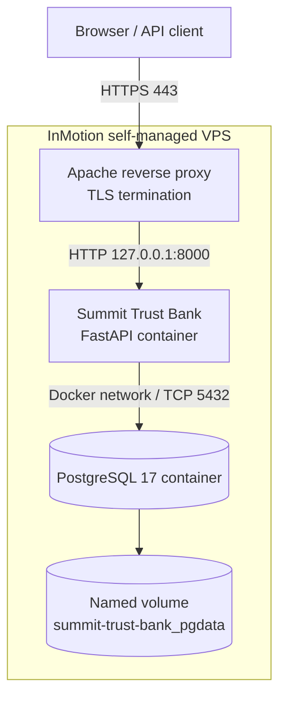
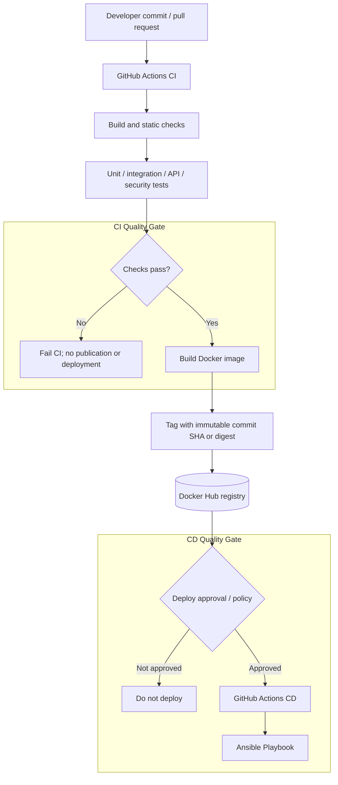

# Summit Trust Bank — Architecture & Software Delivery

> **Status:** Living architecture document  
> **Last updated:** October 10, 2026  
> **Deployment:** [bank.cfhayes.com](https://bank.cfhayes.com)

## 1. Purpose and scope

This document describes the runtime architecture and target software delivery lifecycle for **Summit Trust Bank**, a containerized banking demonstration application. It covers the path from **commit → build → test → package → deploy → post-deployment smoke tests** and identifies which capabilities are operational today versus proposed improvements.

The principal design goals are repeatability, traceability, secure deployment, fast feedback, and preservation of database state during application upgrades.

## 2. Delivery status

| Capability | Status | Notes |
|---|---|---|
| GitHub source repository | In use | Holds application source, Ansible playbooks, and workflows |
| Docker image repository | In use | `cfhayes/summit-trust-bank` on Docker Hub |
| VPS deployment | In use | InMotion self-managed VPS |
| GitHub Actions → Ansible SSH connectivity | Verified | Dedicated `deploy` user and key-based authentication |
| Manually triggered Ansible deployment | Verified | GitHub Actions `deploy.yml` completed successfully |
| Apache HTTPS reverse proxy | In use | `https://bank.cfhayes.com` → FastAPI on `127.0.0.1:8000` |
| PostgreSQL persistence | In use | Compose volume `summit-trust-bank_pgdata` |
| Fully automated build, test, publish, deploy | **Target state** | Not yet established as a complete pipeline |
| Version-pinned deployments / rollback | **Recommended** | Replace mutable `latest` tags with commit-SHA or digest references |
| Comprehensive deployment smoke suite | **Target state** | Current deployment verifies `/docs`; business smoke tests remain to be added |

## 3. System context and runtime architecture

**Runtime boundaries**

- Apache serves the public HTTPS endpoint and proxies traffic to the application.
- The application container publishes port `8000` only on VPS loopback (`127.0.0.1`).
- PostgreSQL is **not published on a host port**; the application reaches the `db` Compose service on port `5432` over Docker's internal network.
- The PostgreSQL data directory is persisted using the named Docker volume `summit-trust-bank_pgdata`.
- The Compose project resides at `/opt/summit-trust-bank`. Its service names are `app` and `db`, and its compose file is `docker-compose.yml`.

The host currently uses Apache and Let's Encrypt certificates for the public endpoint. Adding a second reverse proxy is unnecessary for this deployment.

## 4. End-to-end CI/CD architecture (target state)

> **Important:** The diagram depicts the **intended complete pipeline**. The working deployment today is a manually invoked GitHub Actions workflow that uses Ansible to update the VPS from an image already available on Docker Hub. It is not yet an automatic commit-to-production pipeline.

## 5. Testing architecture and release quality gates

| Stage | Representative tests | Failure policy |
|---|---|---|
| Build and static checks | Linting, formatting, dependency validation, type checks if applicable | Block CI |
| Unit tests | Domain logic, balance rules, input validation | Block CI |
| Integration tests | FastAPI ↔ PostgreSQL, persistence, transactions | Block CI |
| API/security tests | Authentication, account ownership, cross-user access denial, invalid amounts, rate limits | Block CI |
| Package verification | Container builds, starts, and responds to a health endpoint | Block publication |
| Deployment readiness | Docker health status, database connectivity, server-side startup | Block release success |
| Post-deployment smoke | HTTPS, health, login, read account summary, safe synthetic transaction scenario | Mark deployment failed |

### Proposed deployment smoke suite

1. **HTTPS and routing:** Verify DNS resolves, TLS validates, and the desired application endpoint responds through Apache.
2. **Health:** Call a dedicated `GET /health` or equivalent health endpoint returning HTTP `200` only when critical dependencies are usable.
3. **Authentication:** Login with an explicitly provisioned synthetic smoke-test identity.
4. **Read-only account access:** Fetch that identity's account summary and verify the response shape.
5. **Authorization:** Verify that an authenticated user cannot access another user's resources.
6. **Optional controlled write:** Run an idempotent or disposable transaction scenario in isolated test data; clean up or reset afterward.

`GET /docs` currently confirms that the public FastAPI Swagger page is reachable, but it is **not sufficient by itself** to prove that login, account access, or database-backed workflows work.

Smoke tests must not modify shared demo balances unpredictably. Use a dedicated test identity, isolated fixture data, or a resettable environment.

## 6. Security model

- **SSH:** GitHub Actions authenticates as `deploy` using `VPS_SSH_KEY`; `VPS_HOST_KEY` pins the trusted VPS host identity. Keep strict host-key checking enabled.
- **Secrets:** Store private credentials as protected GitHub environment secrets or secure host-side configuration, never in Git. The SSH host key is public; the private deployment key is sensitive.
- **Deployment privileges:** Docker daemon access is effectively root-level access, even without `sudo`. Protect the `deploy` account and its SSH key accordingly, and restrict who can trigger production jobs.
- **Network exposure:** Publish FastAPI to `127.0.0.1:8000` only; do not expose PostgreSQL on a public interface.
- **TLS:** Apache terminates HTTPS. Verify automatic Let's Encrypt renewal, for example with `certbot renew --dry-run`.
- **Application data:** Use fictional banking records only. Publicly advertised demo credentials do not establish user privacy; enforce account ownership in API handlers and avoid reusing those credentials elsewhere.
- **Supply chain:** Pin critical workflow actions, control write permissions, and prefer immutable container versions. Consider dependency and container image scanning.

## 7. Failure recovery and rollback (Future Goal)

| Failure | Response |
|---|---|
| Build/test failure | Fail CI and skip image publication/deployment |
| Image publish failure | Stop; do not deploy an unverified or stale tag accidentally |
| SSH/Ansible failure | Fail CD; inspect authentication, host-key checks, logs, and remote state |
| Container startup failure | Report failed readiness; inspect `docker compose logs app` |
| Smoke test failure | Mark release failed; diagnose or deploy last known-good image |
| Database incompatibility | Stop deployment or invoke a separately reviewed migration/restore procedure |

**Rollback Strategy:** Record the last known-good immutable image reference. Roll back by redeploying that reference for `app`, then run health and smoke checks again. Database schema changes require an independent compatibility and migration plan; reverting the container alone may not safely undo a migration.

Do not claim automatic rollback until an explicit, tested rollback workflow has been implemented.

## 8. Implementation roadmap

### Phase A — Working foundation (completed)

- VPS provisioned with Docker and Compose.
- PostgreSQL started with persistent named storage; no public database port.
- FastAPI deployed through Compose with loopback-only host port.
- Apache HTTPS routing and Let's Encrypt certificate configured.
- Dedicated `deploy` SSH account and host-key verification established.
- GitHub Actions connectivity workflow succeeded.
- Manually triggered GitHub Actions + Ansible deployment succeeded.

### Phase B — Complete the CI/CD chain

1. Add pull-request CI for lint, unit, integration, and security-focused API tests.
2. Build the Docker image only when quality gates pass.
3. Publish images tagged by full commit SHA (or deploy by digest).
4. Pass the tested image reference to Ansible; avoid relying on `latest`.
5. Add GitHub production environment approvals and deployment concurrency control.
6. Replace documentation-only verification with dedicated health and safe business smoke tests.

### Phase C — Operational maturity

- Automated PostgreSQL backups and restore drills.
- Known-good release tracking and a tested rollback procedure.
- Controlled schema migrations with backward compatibility.
- Monitoring, log retention, alerts, and resource-capacity checks.
- Scheduled vulnerability scanning and dependency updates.

## 9. Acceptance criteria for the complete pipeline

The pipeline can be considered end-to-end complete when:

- A commit triggers automated build and tests.
- Test failures prevent packaging or deployment.
- A successful CI run publishes an identifiable, immutable Docker image.
- An approved deployment updates only the `app` service to that exact image.
- PostgreSQL remains online and its persistent data survives application upgrades.
- Health and HTTPS business smoke tests run after deployment.
- The workflow records the image/version deployed and reports clear success/failure status.
- A tested path exists to restore the last known-good application version.
